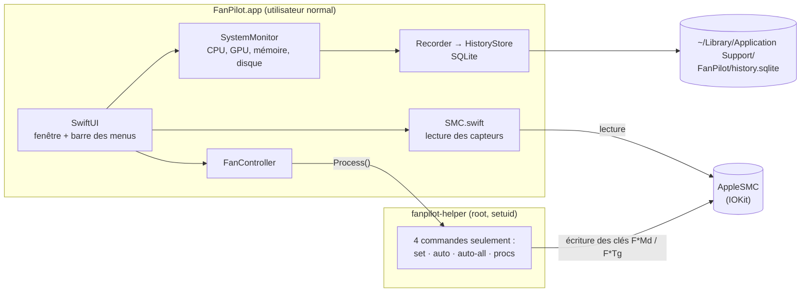

<div align="center">

# 🌀 FanPilot

**Surveille ton Mac et pilote ses ventilateurs, depuis une vraie app native.**


</div>

---

## ✨ Ce que fait FanPilot

| | |
|---|---|
| 🌡️ **Températures** | CPU (cœurs performance / efficacité), GPU, SSD, batterie, Wi-Fi, repose-poignets — et la liste brute de tous les capteurs SMC |
| 📊 **Utilisation** | CPU total et par cœur (E / P), GPU, mémoire, disque, consommation électrique |
| 🌀 **Ventilateurs** | vitesse en direct et 3 modes par ventilateur : **Auto** (macOS décide), **Manuel** (vitesse fixe, jamais sous le minimum Apple), **Courbe** (macOS garde la main sous un seuil, puis montée linéaire jusqu'au max) |
| 📈 **Historique long terme** | tout est enregistré dans une base SQLite locale : graphiques par jour, semaine, mois et année |
| 🔋 **Batterie** | santé, capacité actuelle / d'origine, nombre de cycles |
| 🧩 **Consommation par app** | temps processeur et énergie de chaque app, processus système compris |
| 🖥️ **Barre des menus** | température CPU en permanence, résumé et raccourcis Auto / Max / Courbe |

À la fermeture de l'app, **tous les ventilateurs sont rendus à macOS**.

---

## 🚀 Installer

### Option 1 — l'app prête à lancer
1. Télécharge **`FanPilot-1.0.0-macOS.zip`** dans la [dernière release](../../releases/latest).
2. Dézippe, glisse `FanPilot.app` dans **Applications**.
3. Premier lancement : **clic droit › Ouvrir** (l'app n'est pas notariée par Apple, macOS demande une confirmation une seule fois).

### Option 2 — compiler soi-même
Seuls les **Command Line Tools** sont nécessaires (pas Xcode) : `xcode-select --install`

```sh
./build.sh           # -> build/FanPilot.app
./build.sh install   # -> /Applications/FanPilot.app
```

---

## ⚙️ Comment ça marche



- **Lire** les capteurs ne demande aucun droit particulier : l'app parle directement au SMC (le contrôleur de gestion du Mac) via IOKit.
- **Écrire** une vitesse de ventilateur demande les droits root. Au premier clic sur *« Activer le contrôle des ventilateurs… »*, l'app demande ton mot de passe administrateur et installe un petit **helper** dans `/Library/Application Support/FanPilot/` (propriétaire root, bit setuid).
- Sur Apple Silicon, `thermalmonitord` garde la main sur les ventilateurs : le helper écrit `Ftst=1` pour la libérer, puis passe le ventilateur en manuel.

### 🔒 Sécurité du helper root

Le helper est volontairement minuscule (`Sources/Helper/main.c`, ~150 lignes) :
- il **n'écrit que les clés de ventilateurs** du SMC, rien d'autre — pas de fichier, pas de shell, pas de variable d'environnement ;
- les vitesses sont **toujours bornées** entre le minimum et le maximum fournis par Apple ; les valeurs invalides (négatives, `NaN`, infini) sont refusées ;
- le numéro de ventilateur est vérifié ;
- `procs` est en lecture seule.

```
fanpilot-helper set <ventilo> <rpm>   # mode manuel, bornée min..max
fanpilot-helper auto <ventilo>        # rend le ventilateur à macOS
fanpilot-helper auto-all              # rend tous les ventilateurs à macOS
fanpilot-helper procs                 # lecture seule : temps CPU + énergie de tous les processus
```

**Désinstaller le helper** (bouton dans l'app, ou à la main) :
```sh
sudo rm -rf "/Library/Application Support/FanPilot"
```

---

## 🗂️ Organisation des fichiers

```
FanPilot/
├── build.sh                    compilation sans Xcode (+ install dans /Applications)
├── Resources/
│   ├── Info.plist              identité de l'app (l'identifiant est complété par build.sh)
│   └── make_icon.swift         génère l'icône AppIcon.icns
└── Sources/
    ├── App/                    l'application SwiftUI
    │   ├── FanPilotApp.swift   point d'entrée, barre des menus
    │   ├── RootView.swift      navigation entre les onglets
    │   ├── ContentView.swift   tableau de bord (températures, ventilateurs)
    │   ├── Components.swift    jauges, cartes, éléments réutilisables
    │   ├── FanController.swift modes Auto / Manuel / Courbe, installation du helper
    │   ├── SMC.swift           lecture des capteurs SMC
    │   ├── SystemMonitor.swift CPU, GPU, mémoire, disque, puissance
    │   ├── SystemStats.swift   calculs d'utilisation
    │   ├── ProcessSampler.swift consommation par processus (via le helper)
    │   ├── AppsView.swift      onglet « consommation par app »
    │   ├── Battery.swift       lecture de l'état de la batterie
    │   ├── BatteryView.swift   onglet batterie
    │   ├── Recorder.swift      enregistrement périodique des mesures
    │   ├── HistoryStore.swift  base SQLite
    │   ├── HistoryModel.swift  agrégation jour / mois / année
    │   ├── HistoryView.swift   onglet historique
    │   └── TimeChart.swift     graphiques (Swift Charts)
    ├── Helper/
    │   └── main.c              fanpilot-helper (root) — écrit uniquement les ventilateurs
    └── SMC/                    accès bas niveau en C, partagé par l'app et le helper
        ├── smc.c / smc.h       lecture / écriture des clés SMC (IOKit)
        ├── procs.c / procs.h   temps CPU et énergie par processus
        └── Bridging.h          expose le C à Swift
```

---

## 💻 Compatibilité

| | |
|---|---|
| **macOS** | 14 Sonoma ou plus récent (testé sur macOS 15 Sequoia) |
| **Processeur** | Apple Silicon (testé sur M3 Max) et Intel |
| **Mac sans ventilateur** (MacBook Air) | la section ventilateurs est masquée, le reste fonctionne (non testé) |
| **Compilation** | Command Line Tools (Swift 5.9+, clang) — Xcode non requis |

---

## 🧭 Feuille de route

L'app est **terminée et utilisée au quotidien**. Pistes pour la suite :
- [ ] remplacer le helper setuid par un service privilégié `SMAppService` signé ;
- [ ] signature Developer ID + notarisation (plus de confirmation au premier lancement) ;
- [ ] export CSV de l'historique ;
- [ ] alertes de température personnalisables.

---

<div align="center"><sub>Fait avec SwiftUI, IOKit et un peu de C · aucune donnée ne quitte ton Mac</sub></div>
